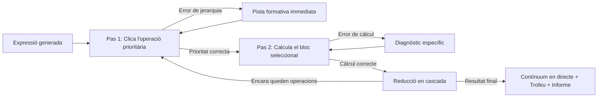

<div align="center">
  
  <h1>Operacions Combinades · Cicle Superior (5è i 6è)</h1>
  <p>
    Aplicació web educativa gamificada per consolidar la <strong>jerarquia de les operacions combinades</strong> a Cicle Superior de Primària, alineada amb el currículum competencial de Catalunya (Decret 175/2022).
  </p>

  <p>
    <a href="https://elcordones.github.io/operacions-combinades/">
      
    </a>
    <a href="#autoria-i-llicències">
      
    </a>
    <a href="https://creativecommons.org/licenses/by-sa/4.0/">
      
    </a>
    
  </p>
</div>

> [!TIP]
> **Accés directe per a l'aula (sense instal·lació):**  
> Obre l'aplicació en qualsevol Chromebook, tauleta, ordinador o PDI des de **[https://elcordones.github.io/operacions-combinades/](https://elcordones.github.io/operacions-combinades/)**.

---

## Nivells i modes de treball

| Mode | Reptes | Continguts principals | Recomanat per a |
| :--- | :---: | :--- | :--- |
| **5è de Primària** | `5` | Ordre d'esquerra a dreta, `×` i `÷`, parèntesis `( )` i introducció a potències (`a²`, `2³`). | Consolidació progressiva sense arrels per defecte. |
| **6è de Primària** | `6` | Tots 4 graons de la piràmide: parèntesis combinats, potències (`a²`, `a³`), arrels exactes (fins a `√144`), `× ÷` i `+ −`. | Repàs complet de final de Cicle Superior. |
| **Mode Personalitzat** | Variable | Selecció lliure d'operacions actives i nombre d'exercicis per repte (`3`, `4` o `5`). | Adaptació docent, reforç específic o DUA. |

---

## Mecànica pas a pas en cascada (Motor AST)

Cada expressió es genera procedimentalment amb un **Arbre Sintàctic Abstracte (AST)** i garanteix invariants estrictes de Primària:
- Tots els resultats intermedis i finals són nombres naturals ($\ge 0$ i $\le 200$).
- Divisions sempre exactes (residu `0`).
- Arrels quadrades sempre exactes (des de `√4` fins a `√144`).



---

## 5 temàtiques amb trofeus col·leccionables

Cada repte superat desbloqueja una peça o insígnia SVG pròpia a la vitrina de la sessió:

| Temàtica | Narrativa a l'aula | Perfil d'ús |
| :--- | :--- | :--- |
| **Missió Cosmos** | Equipa i repara una nau espacial mòdul a mòdul. | Motivació aventurera general. |
| **El Gran Laboratori** | Combina reactius per obtenir fórmules i cristalls. | Ambientació científica. |
| **Expedició Perduda** | Desxifra inscripcions d'un temple antic. | Exploració i enigmes. |
| **Mestre del Codi** | Assembla i activa un robot peça a peça. | Robòtica i pensament computacional. |
| **Mode Clàssic (DUA)** | Estètica neta i d'alt contrast sense distraccions. | Alumnat amb alta sensibilitat sensorial. |

---

## Contínuum de Coneixement i Informe Formatiu

Sense notes numèriques punitives: l'aplicació mesura l'evolució recent de l'alumne mitjançant una mitjana mòbil ponderada (*Sense explorar* → *Iniciant* → *En procés* → *Consolidat* → *Dominat*) en **6 eixos competencials**:

1. **`1-2-3` Ordre i jerarquia** — triar quina operació va primer en cada pas.
2. **`( )` Parèntesis** — prioritzar el que hi ha dins dels blocs.
3. **`aⁿ` Potències** — diferenciar `4² = 4 × 4` de `4 × 2`.
4. **`√` Arrels quadrades** — trobar l'arrel exacta sense confondre-la amb la meitat.
5. **`× ÷` Multiplicacions i divisions** — càlcul exacte i ordre d'esquerra a dreta.
6. **`+ −` Sumes i restes** — càlcul mental i lectura lineal d'esquerra a dreta.

En acabar (o en qualsevol moment des de *Veure informe final*), s'ofereix un **diagnòstic qualitatiu** (*Què domines molt bé* i *On cal posar el focus*), l'historial desplegable pas a pas, una **autoavaluació metacognitiva**, un botó d'**Entrenament Dirigit (3 reptes)** centrat en l'eix més feble i **impressió / exportació neta a PDF**.

---

## Accessibilitat, DUA i Privacitat

- **Mode Clar / Fosc / Dispositiu**: selector directe a la barra superior implementat amb `color-scheme: light dark` i `light-dark()`.
- **Guia ràpida DUA**: modal natiu (`<dialog>`) amb la piràmide de jerarquia consultable en qualsevol moment.
- **Accessibilitat WCAG 2.1 AA**: navegació completa per teclat, sense dependre mai només del color, suport per a `prefers-reduced-motion` i botó de silenci per als efectes sonors (Web Audio API).
- **Privacitat 100% local**: no s'envien ni es recullen dades personals. L'estat es desa únicament al navegador (`localStorage`: `opcomb_v1_session`, `opcomb_v1_muted`, `opcomb_v1_color_mode`). El nom opcional per imprimir l'informe mai no s'emmagatzema.

---

## Arquitectura del projecte

```text
.
├── index.html               # Estructura semàntica, vistes i diàlegs natius
├── favicon.svg              # Icona vectorial (+ − × ÷)
├── .nojekyll                # Desactiva Jekyll a GitHub Pages
├── css/
│   ├── tokens.css           # Design tokens, temes i suport light-dark()
│   ├── layout.css           # Graella responsive i Container Queries
│   ├── components.css       # Cascada interactiva, trofeus, contínuum i peu
│   └── print.css            # Full d'impressió / PDF net en mode clar
├── js/
│   ├── main.js              # Enrutament, mode d'aparença i coordinació
│   ├── themes.js            # 5 temàtiques i trofeus SVG
│   ├── math/
│   │   ├── ast.js           # Motor AST, validació i reducció en cascada
│   │   ├── generator.js     # Generador procedimental amb invariants
│   │   └── hints.js         # Classificador d'errors i diagnòstic formatiu
│   ├── state/
│   │   ├── continuum.js     # Model del Contínuum en 6 eixos
│   │   └── session.js       # Gestió d'estat i persistència localStorage
│   └── ui/
│       ├── setupView.js     # Pantalla inicial de configuració
│       ├── gameView.js      # Tauler interactiu pas a pas
│       ├── continuumView.js # Panell lateral i modal mòbil del Contínuum
│       ├── reportView.js    # Informe formatiu, entrenament dirigit i PDF
│       └── sound.js         # Feedback sonor lleuger via Web Audio API
└── tests/
    └── verify-v1.js         # Bateria de proves automatitzades
```

---

## Ús local i proves

Pots obrir `index.html` directament al navegador (`file://`) sense cap servidor ni dependències externes, o servir la carpeta localment.

Per executar la bateria de proves automatitzades (requereix Node.js):

```bash
node tests/verify-v1.js
```

---

## Autoria i llicències

<div align="center">
  <a href="https://creativecommons.org/licenses/by-sa/4.0/">
    
  </a>
  <p><strong>© David Cordones · 2026</strong></p>
  <p>
    Llicència del codi: <strong>AGPL v3</strong> · Contingut educatiu:
    <a href="https://creativecommons.org/licenses/by-sa/4.0/">CC BY-SA 4.0</a>
  </p>
</div>
